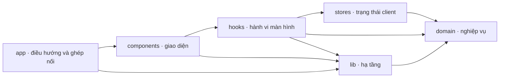
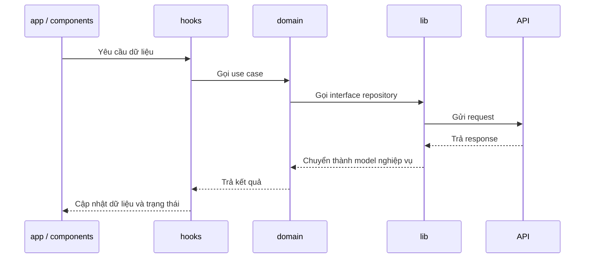

# Kiến trúc BKPractice mobile

Status: Accepted  
Date: 2026-10-24

Ứng dụng dùng Clean Architecture theo nghiệp vụ. `domain` giữ quy tắc cốt lõi;
Expo Router, React Native, API và bộ nhớ thiết bị nằm ở các lớp bên ngoài.
Giữ tên số nhiều `components`, `stores`, `hooks` theo cấu trúc hiện có.
Chỉ tạo thư mục khi có mã nguồn thực sự cần đặt vào đó.

## Sơ đồ thư mục

```text
src/
├── app/          Route, layout và nội dung từng màn hình
├── components/   Thành phần giao diện tách ra từ màn hình
├── domain/       Quy tắc nghiệp vụ
├── stores/       Trạng thái client dùng chung
├── hooks/        Kết nối giao diện với nghiệp vụ
└── lib/          API, lưu trữ và tích hợp nền tảng
```

## Trách nhiệm của từng thư mục

| Thư mục | Chứa gì | Ranh giới |
| --- | --- | --- |
| `src/app/` | Các màn hình, route và layout điều hướng của Expo Router. Mỗi route chứa nội dung và style riêng của màn hình, đồng thời ghép các component cần dùng. Đây cũng là lớp nối implementation trong `lib` với interface của `domain` khi tính năng cần. | Giữ quy tắc nghiệp vụ và thành phần giao diện được tách ra ngoài route. Không tạo component bọc nguyên một route chỉ để đổi chỗ mã. |
| `src/components/` | Thành phần giao diện dùng chung hoặc phần UI có trách nhiệm riêng được tách từ màn hình, kể cả phần điều hướng và UI theo nghiệp vụ. | Nhận dữ liệu và hành động qua props hoặc hooks; không trực tiếp gọi API dữ liệu hay chứa quy tắc nghiệp vụ. |
| `src/domain/` | Model, quy tắc, use case và interface repository của từng nghiệp vụ. | TypeScript thuần; không import Expo, React, UI, store hoặc implementation trong `lib`. |
| `src/stores/` | Trạng thái client cần chia sẻ giữa nhiều màn hình, như phiên đăng nhập, tùy chọn và bản nháp. | State chỉ dùng trong một component ở lại component; dữ liệu server thuộc query cache khi ứng dụng dùng query cache. |
| `src/hooks/` | Hành vi màn hình: gọi use case, quản lý loading/error và nối dữ liệu với UI. | Không chứa quy tắc nghiệp vụ và không phụ thuộc trực tiếp vào chi tiết HTTP hoặc lưu trữ. |
| `src/lib/` | HTTP client, implementation repository, chuyển đổi response, lưu trữ, socket, cấu hình, tích hợp thiết bị và các giá trị theme dùng chung. | Hiện thực các interface do `domain` định nghĩa; không để định dạng API hoặc chi tiết nền tảng lọt vào `domain`. |

Mã theo một nghiệp vụ được nhóm bên trong các thư mục tương ứng khi cần. Thành phần
hoặc hook được nhiều nghiệp vụ dùng chung đặt ở vùng dùng chung của chính thư mục đó.

## Chiều phụ thuộc

Mũi tên dưới đây chỉ chiều **import mã nguồn**, không phải thứ tự chạy. `app` ghép
các phần bên ngoài và cung cấp implementation cần thiết cho use case.



**Quy tắc cốt lõi:** `domain` không import các thư mục còn lại. `lib` phụ thuộc vào
interface trong `domain`, dù lúc chạy use case gọi implementation từ `lib`. Cách này
giữ nghiệp vụ độc lập với API, thư viện giao diện và thiết bị.
`components` và `hooks` có thể đọc cấu hình và giá trị giao diện dùng chung từ `lib`.
Dữ liệu nghiệp vụ đi qua use case và interface của `domain`; các API thuần giao diện
như điều hướng hoặc mở liên kết vẫn có thể nằm ở lớp UI.

## Luồng dữ liệu

Ví dụ khi một màn hình cần dữ liệu từ server:



Biểu đồ luồng chạy không đổi chiều phụ thuộc mã nguồn: `domain` chỉ biết interface
do chính nó định nghĩa. Lỗi mạng và định dạng response được xử lý ở ranh giới
`lib`; `hooks` chuyển kết quả thành trạng thái phù hợp để hiển thị.

## Quy tắc áp dụng

- Dùng Expo Router cho điều hướng; mỗi màn hình nằm ở `app`. Tách component khi
  một phần UI có trách nhiệm riêng hoặc cần dùng lại. Chi tiết thiết bị và mạng
  nằm ngoài `domain`.
- Dùng store cho state client dùng chung. Không sao chép dữ liệu server từ query
  cache vào store chỉ để hiển thị.
- Chọn công cụ theo nhu cầu của tính năng đã được duyệt. Sơ đồ này xác định
  trách nhiệm và chiều phụ thuộc, không buộc cài thêm thư viện hay tạo đủ sáu
  thư mục ngay từ đầu.
